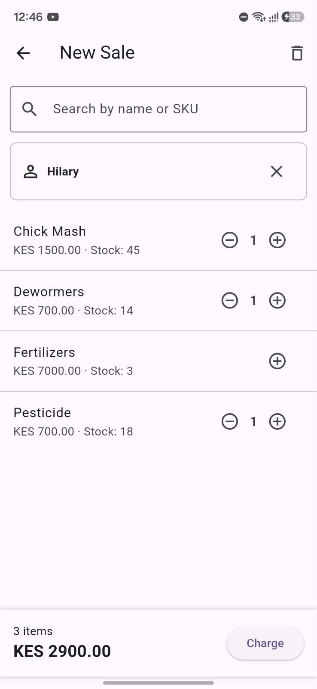
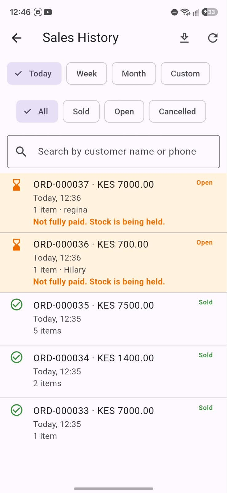
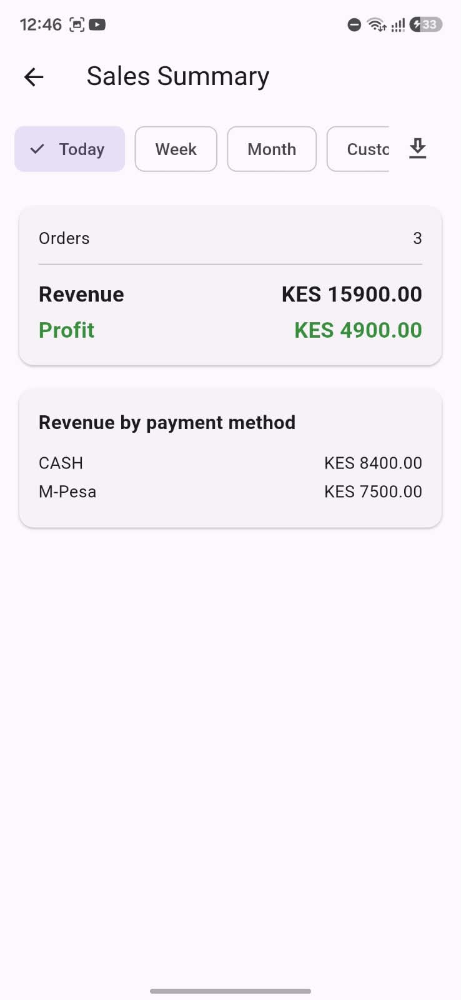
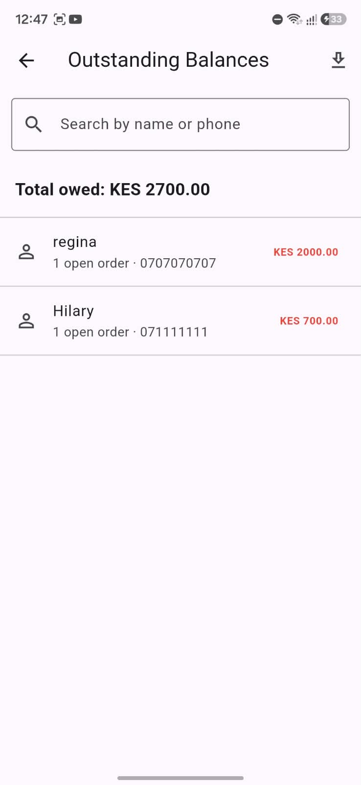
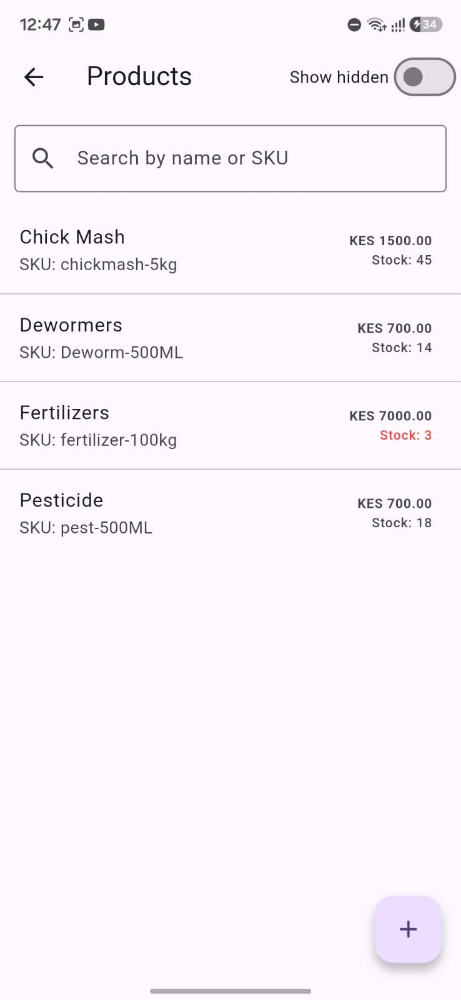

# POS Frontend

A Flutter Android app for a small, single-owner agrovet shop in Kenya. It runs the shop's day-to-day work from one phone: selling, tracking stock, handling credit, and checking profit.

It talks to the [PointOfSale](https://github.com/KingN3V/PointOfSale) FastAPI backend and is used in production by the shop owner.

- **Live API:** https://pointofsale-api.onrender.com (the free tier sleeps when idle, so the first request after a quiet period can take 30-60 seconds)
- **Backend repo:** [KingN3V/PointOfSale](https://github.com/KingN3V/PointOfSale)

## Screenshots

All screenshots use made-up products, customers and phone numbers.

<table>
  <tr>
    <td align="center"><br><sub>New Sale</sub></td>
    <td align="center"><br><sub>Sales History</sub></td>
    <td align="center"><br><sub>Sales Summary</sub></td>
  </tr>
  <tr>
    <td align="center"><br><sub>Outstanding Balances</sub></td>
    <td align="center"><br><sub>Products</sub></td>
    <td></td>
  </tr>
</table>

## Features

- **Login:** JWT authentication with the token kept in secure storage, and a forgot-password flow (emailed code, then a new password). An expired token is detected on launch and sends the user back to login.
- **New Sale:** cart-based checkout with live stock limits, paid by Cash or M-Pesa. A walk-in sale is paid in full; attaching a customer allows partial payment or a fully on-credit sale.
- **Products:** add, edit and search products, with buying and selling prices. Hide or unhide products, and remove stock that expired, was damaged, or was entered by mistake. A warning appears before saving a price with no profit.
- **Restock:** record received stock, with optional new buying and selling prices and a live profit-per-unit line.
- **Categories:** organise products and browse them by category.
- **Customers and credit:** search or add customers during a sale, see who owes what, and record partial or full payments against open orders.
- **Sales History:** filter by status (All, Sold, Open, Cancelled) and timeframe, search by customer name or phone, view order details, cancel an open order (its stock goes back), and export to CSV or Excel.
- **Reports:** sales summary (revenue, profit, revenue by payment method), top products, low stock with an adjustable threshold, and outstanding balances. Each report has a Today / Week / Month / Custom timeframe where it applies, and CSV or Excel export through the system share sheet.

## Tech stack

| Area | Choice |
|---|---|
| Framework | Flutter 3.47.4 (Dart 3.13.3), Material 3 |
| Platform | Android |
| Networking | `http` |
| Token storage | `flutter_secure_storage` |
| Exports | `path_provider` + `share_plus` |
| Backend | FastAPI + PostgreSQL, on Render + Neon |

## Project structure

```
lib/
├── main.dart                  # app entry, theme, AuthWrapper as home
├── models/                    # plain Dart classes with fromJson
│   ├── category.dart
│   ├── customer.dart
│   ├── low_stock.dart
│   ├── order.dart
│   ├── outstanding_balance.dart
│   ├── product.dart
│   ├── sales_summary.dart
│   └── top_product.dart
├── screens/                   # one file per screen
│   ├── auth_wrapper.dart      # decides login vs dashboard on launch
│   ├── login_screen.dart
│   ├── forgot_password_screen.dart
│   ├── reset_password_screen.dart
│   ├── home_screen.dart       # dashboard
│   ├── sale_screen.dart
│   ├── customer_picker_screen.dart
│   ├── sales_history_screen.dart
│   ├── products_screen.dart
│   ├── add_product_screen.dart
│   ├── product_edit_screen.dart
│   ├── restock_screen.dart
│   ├── categories_screen.dart
│   ├── reports_menu_screen.dart
│   ├── sales_summary_screen.dart
│   ├── top_products_screen.dart
│   ├── low_stock_screen.dart
│   ├── outstanding_balances_screen.dart
│   └── customer_orders_screen.dart
├── services/
│   └── api_service.dart       # every backend call lives here
└── widgets/
    └── report_timeframe_bar.dart   # shared Today/Week/Month/Custom + download controls
```

## Running locally

Requirements: Flutter 3.47+ and an Android device or emulator.

```bash
git clone https://github.com/KingN3V/pos_frontend.git
cd pos_frontend
flutter pub get
flutter run
```

**By default the app talks to the live API.** A plain `flutter run` points at the production backend, so anything you create is created there. To use your own backend instead, pass its address at build time:

```bash
flutter run --dart-define=API_BASE_URL=http://<your-ip>:8000
```

With a phone connected over USB you can reach a backend running on your computer without sharing a network:

```bash
adb reverse tcp:8000 tcp:8000
flutter run --dart-define=API_BASE_URL=http://localhost:8000
```

Start the backend as described in the [backend README](https://github.com/KingN3V/PointOfSale#running-locally). Registration is closed on the API, so you need a user created directly in the database to log in.

### Release builds

Release APKs are signed with an upload keystore configured in `android/key.properties`. The keystore and that file are not committed, so `flutter build apk --release` only works with your own signing configuration. Debug builds need none of this.

## How it's built

- **Simple state handling.** Screens are `StatefulWidget`s using `setState`, and every backend call goes through one `ApiService`. For an app this size that keeps the code easy to follow, without a state-management package.
- **The server is the source of truth.** After a sale, restock, payment or cancellation the screen reloads from the server instead of patching local state, so what she sees is what was actually saved.
- **Safe with bad connections.** Money and stock actions close their dialog before the request is sent, so a double tap cannot submit twice. If the connection drops mid-request, the message tells the user to check the order or stock before trying again.
- **Search that doesn't spam the server.** Customer, balance and sales-history searches are debounced, and the history screen ignores slow replies from a filter the user has already left.
- **Correct local times.** The backend stores UTC and sends times without a zone; the app marks them as UTC, then converts to the phone's local time.
- **Stock-aware selling.** The cart cannot exceed stock, and carts are pruned after a refresh if stock changed.
- **Large lists stay fast.** Sales history loads 50 orders at a time with a "Load more" button, while exports include everything that matches the filters.

## Known limitations

- A token that expires **during** an active session is not caught globally yet (it is checked when the app launches). A shared 401 handler in `ApiService` is the planned fix.
- Android only, and online only: there is no offline mode.
- Payment methods are recorded as Cash or M-Pesa and confirmed by the shop owner. M-Pesa STK Push is planned.
